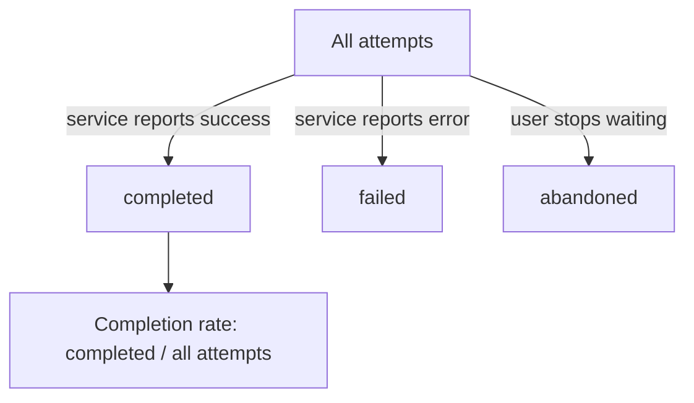

# Task Outcomes, Populations And Denominators

A platform team offers shared capabilities such as creating an environment, deploying a service or finding the owner of a service. The team needs to know whether these capabilities help users finish their work with less avoidable effort. Counting how many times a capability is used does not answer that question. This part shows what to measure instead, and how a missing denominator makes a good number mean nothing.

## Efficiency is about outcomes

Platform efficiency is how well shared capabilities help users complete useful work. It covers delivery flow, reliability, the effort of support and the use of resources. A measure of efficiency describes a result for a user, such as "an environment became usable". A measure of activity only describes that something happened, such as "a request was submitted" or "a person committed code".

Activity counts are easy to collect, which is why teams use them. They have a weakness: they rise when work is wasted. A user who submits a request three times because the first two failed adds three to the request count. The count looks like growth, but the user had a bad experience.

An outcome measure starts from a **task**: one defined piece of work that a user wants to finish with a platform capability. For an environment provisioning service, the task is "get a usable environment". Every attempt to do the task ends in one of a small set of results. In the example data of this module an attempt ends as `completed`, `failed` or `abandoned`. A request is `failed` when the service reports an error. A request is `abandoned` when the user stops waiting or gives up before the service finishes.

## Population and denominator

A **population** is the set of events that a measure describes. A **denominator** is the number that a rate is divided by. For a completion rate, the population is every attempt to do the task, and the denominator is the number of those attempts. A rate with a missing or unclear denominator cannot be checked, because nobody knows what the number is a share of.

The most common error is to build the population from successes only. A report that says "average creation time: 125 seconds" can be correct arithmetic over completed requests and still describe a small part of what users experienced. Requests that failed or were abandoned are not in the average, so the number says nothing about them.



The diagram shows that the denominator of a completion rate is the node `All attempts`, and that all three results sit under it.

## The example data

The playground holds one example. A platform team runs an environment provisioning service for the `starfleet` namespace. The ConfigMap `provisioning-requests` in the namespace `metrics` stores 20 requests as a JSON array. Each record has an `id`, a `class` (`small` or `large`, the size of the environment), an `outcome` and `seconds`, the time from the request until it ended. A dashboard shows "average environment creation time: 125 seconds".

<!-- astrona:playground:renew -->

Read the data out of the ConfigMap into a local file. `kubectl get -o json` prints the ConfigMap as JSON, and `jq`, a command-line program that reads and filters JSON, takes the string stored under the key `requests.json` and writes it to `requests.json`:

```sh
kubectl -n metrics get configmap provisioning-requests -o json | jq -r '.data["requests.json"]' > requests.json
```

Count the attempts:

```sh
jq 'length' requests.json
```

The answer is `20`. Now count how each attempt ended. `group_by(.outcome)` puts records with the same outcome in one group, and `map` turns each group into a small object with its size:

```sh
jq -c 'group_by(.outcome) | map({outcome: .[0].outcome, n: length})' requests.json
```

The output is `[{"outcome":"abandoned","n":3},{"outcome":"completed","n":12},{"outcome":"failed","n":5}]`. Of 20 attempts, 12 completed, 5 failed and 3 were abandoned.

## Where the dashboard number comes from

The dashboard average has a clear definition once you reproduce it. Keep the completed requests, take their `seconds` and compute the mean:

```sh
jq '[.[] | select(.outcome == "completed") | .seconds] | add / length' requests.json
```

The result is `125`. The dashboard is arithmetically right, and it describes 12 of the 20 attempts. The 8 attempts that failed or were abandoned do not appear in it. A reader who sees "125 seconds" will assume that an environment request takes about two minutes, and that assumption is wrong for 40 percent of attempts.

## The completion rate

Add the missing information with a completion rate. It is the number of completed attempts divided by all attempts, times 100:

```sh
jq '([.[] | select(.outcome == "completed")] | length) * 100 / length' requests.json
```

The result is `60`. Only 60 percent of attempts end with a usable environment. This number is a better description of reliability than any time, because a fast service that completes 60 percent of requests is not dependable.

A useful report always shows the rate and the time side by side. The time says how long the successful path takes. The rate says how often a user reaches it. Neither number replaces the other.

## Naming the capability and the period

A measure also needs a defined capability and a defined period. "Completion rate" is incomplete. "Completion rate of environment requests of all teams from 2026-10-01 to 2026-10-31" can be checked and repeated. Without the period, two people compute different numbers from different data and both are right.

Other capabilities have their own task and outcome. For a service catalogue the task is "find the owner or the documentation of a service", and the outcome is a correct answer found, not the number of page views. For a deployment pipeline the task is "get a change into production", and the outcomes are a successful deployment, a failed one or an abandoned one. Define the task first, then the attempts, then the results, and only then compute rates.

The results of an attempt must be exclusive and complete. Each attempt has exactly one result, so the groups add up to the total. In the example, `3 + 12 + 5` equals `20`. When the groups do not add up to the total, some attempts are missing from the data, and the rate is wrong.

## What you know now

An efficiency measure describes the outcome of a defined task for a user. Its population is all attempts, and its denominator is the number of attempts. A mean over completed requests only reports one part of the experience. The completion rate fills the gap. The open question is the time: how long do users wait, and why does one slow request pull the mean away from what most users see? The next part answers that.

## Common pitfalls

> [!WARNING]
> Do not build a rate from successes only. Do not report a number without its population, its period and its denominator. Do not treat a rising request count as a sign of value: failed attempts and retries raise it too.
