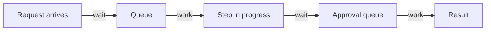

# Flow, Wait Time And Work In Progress

Completion rate and time to complete describe the outcome of a task. They do not say where the time goes. A request can spend most of its life waiting in a queue and only a small part being worked on. This part separates wait time from work time, defines flow efficiency and work in progress, and shows why reducing waiting is often the largest gain a platform can deliver.

## Wait time and work time

The **total time** of a request is the time from the moment the user asks to the moment the user has a result. It has two parts. The **work time** is the time when a person or an automated step is actively doing something for the request. The **wait time** is the time when the request sits in a queue, waits for an approval or waits for a person to look at it. A platform that automates a step removes the work of that step. A platform that removes an approval removes a wait.

The **flow efficiency** is the work time divided by the total time, times 100. A flow efficiency of 100 percent means the request never waits. In manual processes, values below 20 percent are common, which means that most of the time is waiting.

## A worked example

The provisioning data in this module has only one time per request, so it cannot show the split. The example below uses four requests with two times each, in seconds. You can run it without the cluster, because the data is in the command:

<!-- astrona:playground:renew -->

```sh
echo '[{"id":"a","wait":300,"work":60},{"id":"b","wait":120,"work":90},{"id":"c","wait":900,"work":60},{"id":"d","wait":60,"work":120}]' | jq -c '[.[] | {id, total: (.wait + .work), efficiency: ((.work * 100 / (.wait + .work)) | floor)}]'
```

The output is `[{"id":"a","total":360,"efficiency":16},{"id":"b","total":210,"efficiency":42},{"id":"c","total":960,"efficiency":6},{"id":"d","total":180,"efficiency":66}]`. The efficiency is rounded down to a whole percent. Request `c` took 960 seconds in total and worked for only 60 of them. The work times of the four requests are close to each other, between 60 and 120 seconds. The wait times differ from 60 to 900 seconds. The variation of the total time comes from waiting.

Now compute the flow efficiency of the whole set:

```sh
echo '[{"id":"a","wait":300,"work":60},{"id":"b","wait":120,"work":90},{"id":"c","wait":900,"work":60},{"id":"d","wait":60,"work":120}]' | jq -c '{wait: ([.[].wait] | add), work: ([.[].work] | add), flow_efficiency_percent: (([.[].work] | add) * 100 / (([.[].wait] | add) + ([.[].work] | add)))}'
```

The output is `{"wait":1380,"work":330,"flow_efficiency_percent":19.29824561403509}`. The four requests spent 1380 seconds waiting and 330 seconds being worked on. Speeding up the work steps by half would save 165 seconds. Removing the queue for request `c` alone would save up to 900 seconds. The platform team should look at the waits first.

## Work in progress and throughput

**Work in progress (WIP)** is the number of requests that were started and are not finished. **Throughput** is the number of requests finished in a period. When the WIP is high, each request waits longer, because the people and systems who handle them are shared. The relation between the three is known as **Little's law**: the average WIP equals the average throughput times the average time a request spends in the system. If a team finishes 10 requests a day and each takes 3 days, about 30 requests are in progress at any time. If the team stops starting new requests until the WIP falls to 20, the average time falls to 2 days with the same throughput.

The law holds for a system in steady state, where the work that comes in equals the work that goes out. It is a way to reason about queues and not a promise about one request.



The diagram shows a request that alternates between waiting and being worked on. Each wait is a place where a platform capability, such as an automatic policy check, can remove time.

## What a platform changes

Self-service provisioning removes the queue in front of a human. Policy as code replaces a manual approval with an automated check that takes seconds. Limits on WIP, for example a rule that the platform team works on at most five requests at once, prevent a long queue from forming. The measure that shows the effect is the wait time, not the work time.

## What you know now

The time of a request is the sum of waiting and work. Flow efficiency shows how much of it is work, and in manual processes most of it is waiting. WIP, throughput and time in the system are linked, so limiting WIP shortens the time. The open question is how much of the platform's effort goes into failures and abandoned requests, which the next part measures.

## Common pitfalls

> [!WARNING]
> Do not shorten work steps when the time is spent in queues. Do not apply Little's law to a system that is not in steady state without saying so. Do not measure wait time by the clock of one tool when the request waits across several tools.
