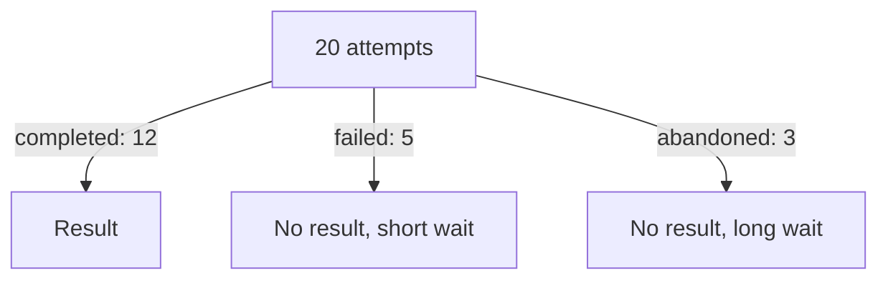

# Failures, Abandonment And Wasted Time

A request that does not complete is not neutral. The user spent time, the platform spent resources and the user still has nothing. This part measures the cost of failed and abandoned requests, compares the classes and explains why abandonment is often the signal that users have stopped trusting the capability.

## Failed and abandoned are different

A **failed** request ends because the platform returned an error. An **abandoned** request ends because the user stopped waiting or gave up. They have different causes and different owners. A failure is a defect or a limit in the platform and the platform team can fix it. Abandonment is a user decision, and the cause can be a long wait, a confusing form or a belief that the request will fail. The platform team learns the cause by asking.

<!-- astrona:playground:renew -->

Save the data from the ConfigMap if you do not have the file:

```sh
kubectl -n metrics get configmap provisioning-requests -o json | jq -r '.data["requests.json"]' > requests.json
```

Group the requests by outcome and compute the count, the total seconds and the mean seconds of each group:

```sh
jq -c 'group_by(.outcome) | map({outcome: .[0].outcome, n: length, total_seconds: ([.[].seconds] | add), mean: (([.[].seconds] | add) / length)})' requests.json
```

The output is `[{"outcome":"abandoned","n":3,"total_seconds":3600,"mean":1200},{"outcome":"completed","n":12,"total_seconds":1500,"mean":125},{"outcome":"failed","n":5,"total_seconds":240,"mean":48}]`. The 12 completed requests used 1500 seconds. The 8 requests that did not complete used 3840 seconds, which is 3600 plus 240. Most of the time that users spent on this service produced nothing.

Failed requests are quick: they ended after 48 seconds on average. Abandoned requests are long: 1200 seconds on average. The users waited 20 minutes and then gave up. The time cost of abandonment is 15 times the time cost of a failure in this data, although there are fewer abandoned requests.

## Where the failures and abandonments happen

Break the two outcomes down by class:

```sh
jq -c 'group_by(.class) | map({class: .[0].class, attempts: length, failed: ([.[] | select(.outcome == "failed")] | length), abandoned: ([.[] | select(.outcome == "abandoned")] | length)})' requests.json
```

The output is `[{"class":"large","attempts":8,"failed":4,"abandoned":2},{"class":"small","attempts":12,"failed":1,"abandoned":1}]`. In the `large` class, 6 of 8 requests ended without a result. In the `small` class, 2 of 12 did. A fix for `large` requests covers most of the waste.

List the abandoned requests with their class:

```sh
jq -c '[.[] | select(.outcome == "abandoned") | {id, class, seconds}]' requests.json
```

The output is `[{"id":"r18","class":"large","seconds":1200},{"id":"r19","class":"small","seconds":900},{"id":"r20","class":"large","seconds":1500}]`. Two of the three abandoned requests are large. They show users who waited from 15 to 25 minutes.

## Why this is a platform problem

Users who see a failure or a long wait learn to avoid the capability. They create environments with their own scripts, and the platform loses its value. The cost does not appear in the platform's own numbers, because an abandoned request is silent. This is why the completion rate counts abandoned attempts in the denominator.

A team can reduce the waste in three ways. It can make the error message say what to fix, which reduces retries. It can show the user the expected wait and the current state, which reduces abandonment. It can fix the cause of the failures of the worst class. The measure to watch is the completion rate of the worst class, together with the share of total user time that went to requests without a result.



The diagram shows that the attempts end in three ways and that two of them leave the user without a result.

## What you know now

Failed and abandoned requests have different causes and a high cost in user time. In this data, requests without a result used more than twice the time of completed requests, and one class holds most of them. The completion rate, the time of failed and abandoned requests and a breakdown by class together point to the capability that needs work.

## Common pitfalls

> [!WARNING]
> Do not merge failed and abandoned requests into one group. Do not count only the time of completed requests as the time users spend. Do not assume that a user who abandoned a request left because of the platform without asking.
