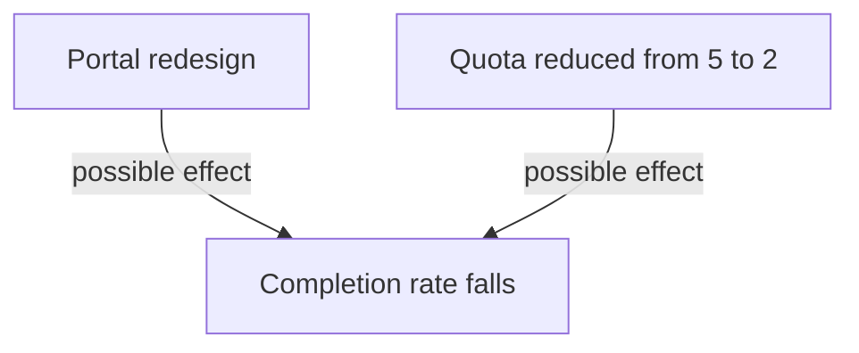

# Incentives, Context And Causation

A metric is not only a description. Once people know that a number is watched, their behaviour changes, and the number can stop describing what it was meant to describe. A metric is also read against a context: other changes in the same period, different teams and different products. This part explains how measures create incentives, how to guard against gaming, and what a before-and-after comparison can and cannot prove.

## Measures create incentives

An **incentive** is anything that makes one behaviour more attractive than another. A measure that is used in a performance review, a target or a ranking becomes an incentive. People then work to move the number, which is not always the same as working to improve the thing that the number represents.

Goodhart's law states this: when a measure becomes a target, it stops being a good measure. Four examples show the mechanism. If a team is ranked by commits, developers split one change into many small commits, and the number rises while the work does not change. If a team is rewarded for the number of deployments, it ships low-value changes to raise the count. If support is judged by the number of open tickets, agents close tickets early. If the platform team is judged by tickets per session, it can reach the target by hiding the help link in the portal.

Each example follows the same rule. The measure is a proxy, a number that stands in for something harder to see. The more weight the proxy carries, the more effort goes into the proxy and the less into the thing it stood for.

## Guarding against gaming

A team cannot remove incentives, but it can reduce their harm. Four habits help.

- Use a small set of measures that balance each other. A fall in tickets read with a completion rate shows when a gain is false, because a gamed ticket count does not raise completion.
- Use measures to find problems and start a discussion, not to rank people or teams. A measure that decides pay or promotion is gamed fastest.
- Look at the data behind the number. A comment from a survey, a sample of failed requests or a look at a workaround shows what a metric hides.
- Say in advance what each measure is for, who sees it and what decisions it can change. A measure with no decision attached only invites decoration.

Measures also have a human cost. Ranking individuals by activity can discourage unglamorous work such as helping another team, writing documentation or reviewing code. Platform work in particular often reduces waiting for other people, and waiting does not show up in an individual activity count.

## Context and causation

A before-and-after comparison measures a metric in one period and again in a later period, around a change. It is the most common way to judge a platform change, and it is weaker than it looks. The two periods differ in more than the change under test. **Causation** means that the change produced the effect. A before-and-after difference only shows that the numbers differ. It does not show why.

A **confounder**, or confounding change, is another event in the same period that could produce the same effect. A traffic change, a release of another team, a holiday, a new quota or a change of survey wording are all confounders. When a confounder exists, a team cannot assign the effect to its own change without more evidence.



The diagram shows two changes in the same period that can each explain the one observed effect.

## The example: a redesign and a quota

<!-- astrona:playground:renew -->

The playground holds the data of a portal redesign. A status report says that tickets fell from 80 to 54 after the redesign, so the redesign worked. Read the change log first. It is stored in the ConfigMap `platform-changes`:

```sh
kubectl -n metrics get configmap platform-changes -o json | jq -r '.data["changes.json"]' > changes.json
jq -r '.[] | .date + " " + .change' changes.json
```

The log has two lines: `2026-10-01 Portal redesign released` and `2026-10-12 Environment quota per team reduced from 5 to 2`. The redesign is not the only change in the period. Now save the usage data and compute the totals for the two periods. Month strings such as `2026-10` sort in date order, so a comparison with `<` and `>=` selects the months:

```sh
kubectl -n metrics get configmap portal-usage -o json | jq -r '.data["usage.json"]' > usage.json
jq -c '[.[] | select(.month < "2026-10")] | {sessions: ([.[].sessions_started] | add), completed: ([.[].tasks_completed] | add), tickets: ([.[].tickets] | add)}' usage.json
jq -c '[.[] | select(.month >= "2026-10")] | {sessions: ([.[].sessions_started] | add), completed: ([.[].tasks_completed] | add), tickets: ([.[].tickets] | add)}' usage.json
```

Before the change, there were 400 sessions, 320 completed tasks and 80 tickets. After it, there were 400 sessions, 220 completed tasks and 54 tickets. The completion rate went from 80 to 55 percent. Tickets fell by 26, and 100 fewer tasks were completed. The report that celebrates the ticket count leaves out the larger movement.

## What the data can and cannot show

The data shows that more sessions ended without a completed task after October. It does not show whether the redesign or the quota reduction caused it. A smaller quota can block a request by itself, with no problem in the portal. The data is monthly, and both changes fall in October, so the months cannot separate them.

A stronger design would compare more precisely. Daily data would show whether the completion rate fell on 2026-10-01 or on 2026-10-12. The reason attached to each failed request would show whether it was refused by the quota. A group of users on the old portal over the same weeks would give a comparison that shares the same quota. Each of these answers a question that the monthly totals cannot.

State the result with its limits: "The completion rate fell from 80 to 55 percent in the two months after the redesign and the quota change. The data cannot separate the two changes." That sentence is weaker than "the redesign failed", and it is the one the evidence supports.

## A checklist before you trust a trend

Before a team reports that a platform change worked, it can ask five questions of its own data. Each question points at a specific kind of error.

1. What is the denominator, and did it change between the periods? A rate that falls because usage doubled says little.
2. Which attempts are missing? Failed and abandoned attempts, and users who bypass the platform, are the usual gaps.
3. Which other changes happened in the same period? Read the change log of the platform, of the products that use it and of the process around it.
4. Does a second measure agree? A fall in tickets that comes with a fall in completion is a conflict, and the conflict needs an explanation.
5. Could the measure be gamed, and by whom? If a person is judged by it, assume that behaviour will move toward the number.

A report that answers these questions in a few sentences is more useful than a chart with a clean trend. It also protects the team: when a result is later questioned, the limits are already written down.

## Comparing teams and services

The same care applies when a team compares one product with another. Teams serve different traffic, different compliance rules and different users. A lower ticket rate in one team can reflect a simpler product. Compare a team with its own past, and compare groups only when their context is close enough that the difference is meaningful.

## What you know now

A measure that becomes a target is gamed, so a team uses a small balanced set, reads each number against another and uses measures to improve the system instead of ranking people. A before-and-after difference shows that numbers differ, and a confounder can explain the difference. A report states the evidence, the limits and the changes in the period it could not separate.

## Common pitfalls

> [!WARNING]
> Do not rank people or teams by one activity count. Do not credit a platform change for a trend without checking for other changes in the same period. Do not write a causal claim when the data only shows a difference.
