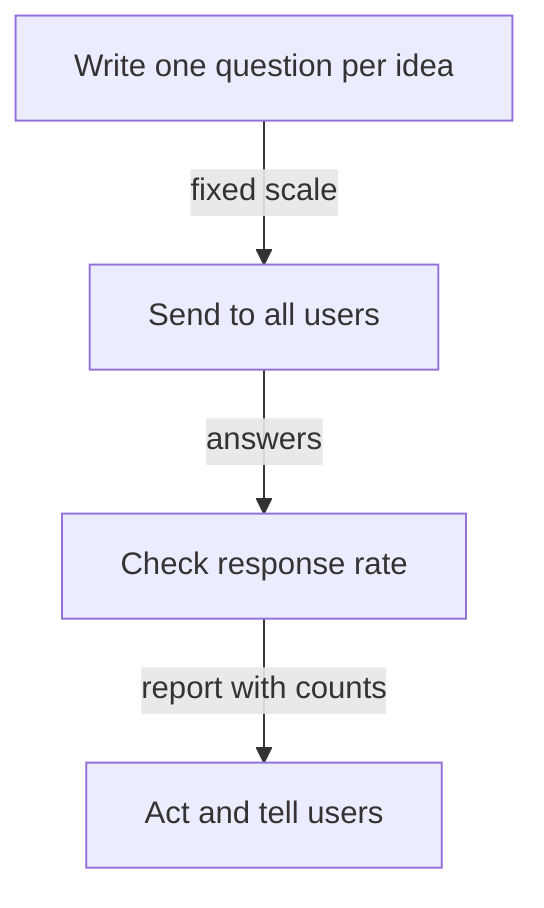

# Designing Developer Surveys: Questions, Scales And Response Bias

A survey is the main tool for measuring how developers feel about a platform. A badly designed survey gives numbers that look precise and mean little. This part covers how to write a question, choose a scale, read the answers and judge whether the respondents represent the users.

## One question, one idea

A good survey question asks about one thing, uses plain words and does not suggest an answer. "How satisfied are you with the speed and reliability of the portal?" asks two things, and a person who finds it fast and unreliable cannot answer. Split it into two questions. "Don't you agree that the new portal is easier?" suggests the answer. Write "How easy or hard is it to create an environment in the portal?".

A question must refer to a recent, concrete experience: "the last time you created an environment" is easier to answer honestly than "in general".

## Scales

A scale gives the answers a fixed order. Common choices are a five-point scale from "very hard" to "very easy" or a score from 1 to 5. The same scale and the same wording should be used each time, so that answers from different rounds can be compared. A scale with an odd number of points allows a neutral answer. A scale with an even number forces a choice. The team picks one and keeps it.

The survey data of this module uses scores from 1 to 3 where a lower score is a worse experience, and a `theme` and a `comment`.

<!-- astrona:playground:renew -->

Save the survey from the ConfigMap:

```sh
kubectl -n metrics get configmap survey-responses -o json | jq -r '.data["survey.json"]' > survey.json
```

Count the answers for each score and compute the average:

```sh
jq -c 'group_by(.score) | map({score: .[0].score, n: length})' survey.json
jq '[.[].score] | add / length' survey.json
```

The output is `[{"score":1,"n":1},{"score":2,"n":6},{"score":3,"n":5}]` and `2.3333333333333335`. One person gave 1, six gave 2 and five gave 3. Seven of the twelve answers are 1 or 2, the two lowest scores. The distribution tells more than the average of 2.33.

For ordered answers such as scores, the distribution and the share of each answer are safer than the average, because the distance between a 1 and a 2 is not necessarily the same as the distance between a 2 and a 3.

## Response rate and bias

The **response rate** is the number of answers divided by the number of people invited. The survey has 12 answers. If 40 developers were invited, the response rate is 30 percent. **Response bias** appears when the people who answer differ from the people who do not. People with strong opinions answer more often, and people who gave up on the platform may not answer at all.

A team reports the number of invited people, the number of answers and who is missing. It checks the respondents against the user list, for example by team size and by how long they have used the platform. If one team provides 8 of the 12 answers, the result describes that team.

## Anonymity and trust

Developers answer honestly when they believe that their answers will not be used against them. The team states who can see the answers and reports groups of at least a minimum size, for example five people, so that nobody can be identified. A survey that is followed by visible action gets more answers next time.



The diagram shows the order of a survey: write, send, check who answered and act.

## What you know now

A good survey asks one concrete question at a time, keeps the same scale between rounds and reports the distribution and the response rate. The answers describe the people who answered, so the team states who is missing. The open question is how to learn why people answered as they did, which needs qualitative methods.

## Common pitfalls

> [!WARNING]
> Do not ask two things in one question. Do not report an average without the distribution and the number of answers. Do not change the scale between rounds and compare the results.
