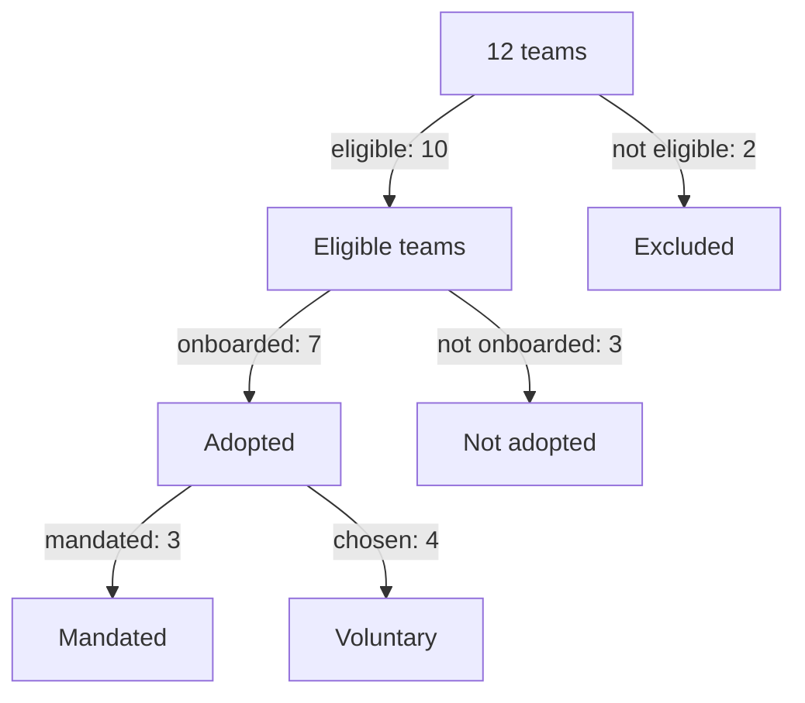

# Adoption Rate And Active Use

A platform team can build a good capability and still help nobody. The first question about a platform is therefore simple: how many of the teams that could use it do use it. This part defines the adoption rate, shows why the denominator needs care, and explains why adoption that the organisation forces says less than adoption that teams choose.

## What adoption means

**Adoption** is the share of the intended users that use a platform capability for real work. The intended users are the **eligible** teams. A team is eligible when the capability is meant for it and it can use it. A legacy system that the platform does not support, or a team that owns no running service, is not eligible and does not belong in the denominator.

The adoption rate is the number of eligible teams that use the capability, divided by the number of eligible teams, times 100. This is the same rule as the completion rate of a task: the denominator is the whole population that was supposed to be served. If ineligible teams are counted, the rate looks worse than it is. If only teams that already use the platform are counted, the rate is always 100 percent and says nothing.

## A worked example

The example data has 12 teams. Each record has a `team`, the flags `eligible`, `onboarded` and `mandated`, the number of days to the first deployment, the monthly count of manual tickets and self-service requests, and two survey scores. Two teams, `t10` and `t12`, are not eligible.

<!-- astrona:playground:renew -->

Save the data from the ConfigMap into a local file:

```sh
kubectl -n metrics get configmap team-adoption -o json | jq -r '.data["teams.json"]' > teams.json
```

Count the eligible teams and the eligible teams that are onboarded:

```sh
jq '[.[] | select(.eligible)] | length' teams.json
jq '[.[] | select(.eligible and .onboarded)] | length' teams.json
```

The output is `10` and `7`. The adoption rate is 7 divided by 10, which is 70 percent. If the two ineligible teams were counted, the rate would be 7 divided by 12, which is 58.3 percent, and the platform team would be blamed for teams it cannot serve.

List the eligible teams that have not adopted the platform:

```sh
jq -c '[.[] | select(.eligible and (.onboarded | not)) | .team]' teams.json
```

The output is `["t06","t07","t11"]`. A rate says how far adoption has gone. The list says whom to talk to next.

## Adopted is not the same as active

A team that onboarded once and never deploys again is counted as adopted, but it gets no value. **Active use** is stricter: the team used the capability during a stated period, for example at least one deployment through the platform in the last 30 days. The report must state the period and the rule. A rate that counts "ever onboarded" and a rate that counts "active in the last 30 days" are two different measures, and they should be reported under two different names.

## Mandated and voluntary adoption

Some teams use the platform because they chose to. Others use it because a rule says they must, for example a policy that every new service deploys through the platform pipeline. The field `mandated` marks those teams.

```sh
jq '[.[] | select(.onboarded and .mandated)] | length' teams.json
jq '[.[] | select(.onboarded and (.mandated | not))] | length' teams.json
```

The output is `3` and `4`. Of the 7 adopting teams, 3 were required to adopt and 4 chose to. A high adoption rate that comes mostly from mandates measures the power of the rule. It does not show that the platform is useful. The voluntary share is the better signal of value, and the later parts of this module show that mandated teams also report lower satisfaction and slower onboarding.



The diagram shows how the 12 teams split into excluded, adopted and not adopted, and how the adopted teams split by the reason they adopted.

## Adoption over time

One adoption rate is a snapshot. Teams read a trend. The platform team records the rate at the end of each month with the same eligibility rule and the same definition of adopted. If the rule changes, the old numbers must be recomputed with the new rule, or the line on the chart shows a change of definition and not a change of behaviour.

## What you know now

Adoption is the number of eligible teams that use a capability divided by the number of eligible teams. The report states who is eligible, what adopted means and over which period, and it separates mandated teams from voluntary ones. The open question is how long a team waits before it gets value, which the next part measures as onboarding time.

## Common pitfalls

> [!WARNING]
> Do not count ineligible teams in the denominator. Do not call a team adopted without stating whether the rule is "ever onboarded" or "active in a period". Do not present mandated adoption as proof that teams like the platform.
