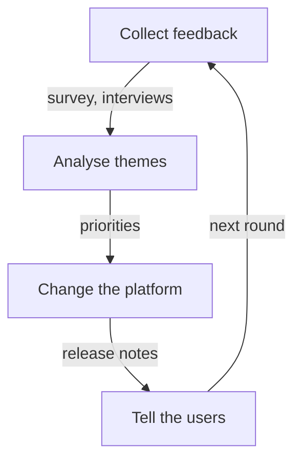

# The Platform As A Product: Satisfaction And Feedback

A platform team that treats the platform as a product asks its users what they need, measures whether they are satisfied and changes the product from what it learns. The users are the application teams. They often cannot leave the platform, so their satisfaction does not show up as sales and must be measured directly. This part computes a satisfaction score and an NPS and explains how to combine them with adoption.

## Why satisfaction needs its own measure

Adoption says that teams use the platform. It does not say that they like it. A team that is forced to use a slow platform is adopted and unhappy. The two measures answer different questions, so the report holds both. A **platform as a product** approach means that the team has users, a roadmap built from user needs and a regular way to collect feedback.

## Customer satisfaction score

The **customer satisfaction score (CSAT)** comes from one survey question, for example "How satisfied are you with the platform?" answered on a scale from 1 to 5. The CSAT is often reported as the share of respondents who answer 4 or 5, which counts the satisfied ones. Only teams that answered belong in the denominator.

<!-- astrona:playground:renew -->

Save the data from the ConfigMap if you do not have the file:

```sh
kubectl -n metrics get configmap team-adoption -o json | jq -r '.data["teams.json"]' > teams.json
```

List the scores of the teams that answered:

```sh
jq -c '[.[] | select(.csat != null) | .csat] | sort' teams.json
```

The output is `[2,2,3,4,4,5,5]`. Seven teams answered. Four of them scored 4 or 5, so the satisfied share is 4 divided by 7, which is 57.1 percent. In one command:

```sh
jq '[.[] | select(.csat != null)] | (([.[] | select(.csat >= 4)] | length) * 100 / length)' teams.json
```

The output is `57.142857142857146`. The report states that 7 of 10 eligible teams answered. The three teams that did not answer are the teams that did not onboard, so their opinion is missing.

## Net Promoter Score

The **Net Promoter Score (NPS)** comes from the question "How likely are you to recommend the platform to a colleague?" answered from 0 to 10. A score of 9 or 10 is a **promoter**. A score of 0 to 6 is a **detractor**. Scores of 7 and 8 are **passive**. The NPS is the share of promoters minus the share of detractors, in points from -100 to 100.

```sh
jq '[.[] | select(.nps != null)] | ((([.[] | select(.nps >= 9)] | length) - ([.[] | select(.nps <= 6)] | length)) * 100 / length)' teams.json
```

The output is `-14.285714285714286`. Among 7 respondents there are 2 promoters (scores 10 and 9), 3 detractors (6, 4 and 3) and 2 passives. The NPS is (2 minus 3) divided by 7, times 100, which is -14.3.

A negative NPS in a small group is a signal to investigate, and a team of seven respondents cannot give a precise value. One answer changes the NPS by about 14 points here. The report must show the number of respondents.

## Satisfaction by kind of adoption

Compare the average CSAT of mandated teams with the average of voluntary teams:

```sh
jq '[.[] | select(.onboarded and .mandated) | .csat] | add / length' teams.json
jq '[.[] | select(.onboarded and (.mandated | not)) | .csat] | add / length' teams.json
```

The output is `2.3333333333333335` and `4.5`. Teams that were required to adopt score 2.3 and teams that chose the platform score 4.5. Together with the onboarding times of 9, 12 and 20 days for the mandated teams, the data shows that the mandate brought teams in but did not make them satisfied. It does not prove why, and a conversation with the three teams is the next step.

## Feedback loops

A **feedback loop** is a regular path from user opinion to a change in the product. Common sources are a short survey after onboarding, a quarterly survey, interviews with a few teams, ticket themes and a public backlog where users can see what is planned. The loop is only complete when the team tells users what changed. A survey without a visible result teaches users to stop answering, and then the response rate falls.



The diagram shows the loop: collect, analyse, change, tell the users and collect again.

## What you know now

A platform measured as a product has adoption, onboarding time, self-service rate, CSAT and NPS. Each answers a different question, and each needs its denominator and its number of respondents. Reading them together shows when adoption is forced and when satisfaction is real. The numbers describe a situation, and interviews and feedback loops explain it.

## Common pitfalls

> [!WARNING]
> Do not report CSAT or NPS without the number of respondents and the response rate. Do not treat adoption as satisfaction. Do not run a survey and leave users without a visible result.
