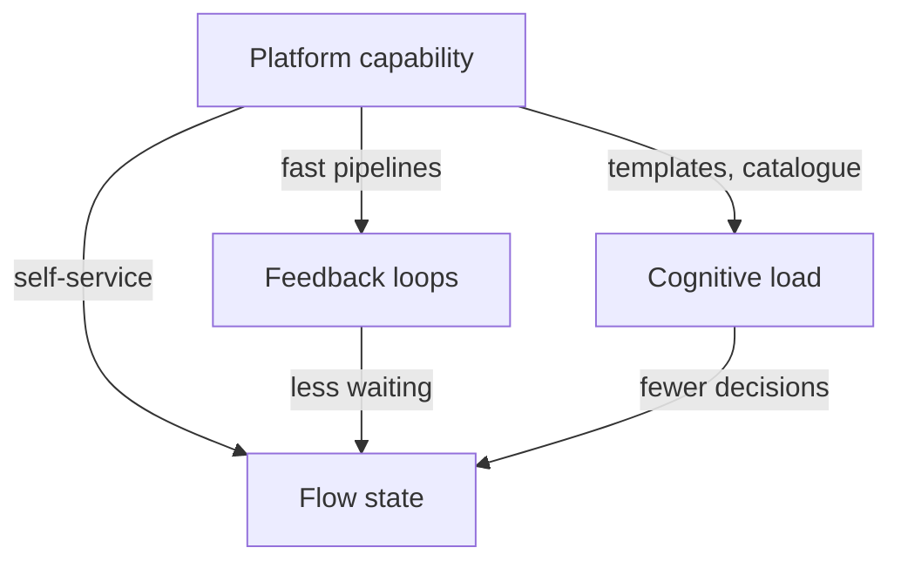

# The DevEx Framework: Feedback Loops, Cognitive Load And Flow

SPACE tells a team which kinds of measure to combine. The Developer Experience (DevEx) framework goes the other way: it starts from what a developer lives through every day and names the three things that matter most. A platform team can act on all three, so this framework is closely tied to what a platform does.

## Three areas of developer experience

The **DevEx framework** was proposed by researchers who studied what makes developer experience good. It names three core areas:

- **Feedback loops:** how fast and how clearly developers get an answer from the tools and people around them. Examples are the time a build takes, the time a test run takes and the time a code review waits.
- **Cognitive load:** how much a developer must hold in mind to finish a task. Examples are the number of tools, steps and systems in a workflow, and the amount of unfamiliar knowledge needed.
- **Flow state:** how much uninterrupted time a developer has to work on one task with full attention. Interruptions, meetings and waiting break flow.

Slow feedback makes developers switch to other work while they wait, which breaks flow and adds load. The three areas affect one another, and one change often moves all of them.

## Perceptual and workflow measures again

The DevEx framework also asks for two kinds of data for each area. A **perceptual measure** records how developers feel about the area, for example "How satisfied are you with the speed of the build?". A **workflow measure** records what the system shows, for example the median build time. A fast build with unhappy developers means that something else, such as unreliable builds, matters. Both kinds are needed to see this.

<!-- astrona:playground:renew -->

The metric catalogue has a field `devex` that names the area a metric describes, or `none`. Save the catalogue if you do not have it:

```sh
kubectl -n metrics get configmap metric-catalogue -o json | jq -r '.data["metrics.json"]' > metrics.json
```

List the metrics that map to a DevEx area, with the area:

```sh
jq -c '[.[] | select(.devex != "none") | {metric, devex}] | sort_by(.devex)' metrics.json
```

The output has five records: `tools per workflow` and `time to first deployment` map to cognitive load, `review turnaround hours` and `build wait minutes` map to feedback loops, and `interruptions per day` maps to flow state. The catalogue has two metrics each for feedback loops and cognitive load and only one for flow state. A team that wants to improve focus time has one metric to watch, and it is a perceptual one.

Show which of the five are perceptual:

```sh
jq -c '[.[] | select(.devex != "none" and .measure == "perceptual") | .metric]' metrics.json
```

The output is `["interruptions per day"]`. The other four are workflow measures. The set has no perceptual question about cognitive load or feedback loops, so it cannot show if a short build still feels slow.

## What a platform changes in each area

A platform team improves the three areas with the platform itself. For feedback loops, it provides fast pipelines, cached builds and preview environments. For cognitive load, it provides templates and a service catalogue so that developers do not have to learn every tool. For flow, it provides self-service so that developers do not wait for tickets and hands off fewer steps to other teams.



The diagram shows that three kinds of capability act on the three areas, and that faster feedback and lower load both support flow.

## Choosing where to look first

Developer surveys in the DevEx method ask for each area how much a problem costs developers, for example hours lost per week, and how many developers are affected. The platform team ranks the problems by the time lost across the organisation. A problem that costs one hour a week for 300 developers is more urgent than a problem that costs five hours a week for three developers. The ranking is an estimate from survey answers and the team states that.

## What you know now

The DevEx framework names feedback loops, cognitive load and flow state as the three areas where developer experience is made, and asks for a perceptual and a workflow measure in each. Each area has platform capabilities that move it. The open question is how to measure cognitive load, which does not appear in any pipeline, and that is the next part.

## Common pitfalls

> [!WARNING]
> Do not measure only the workflow side of an area. Do not treat the three areas as independent, because one change often moves all of them. Do not rank problems by how loudly developers complain instead of by the time lost.
