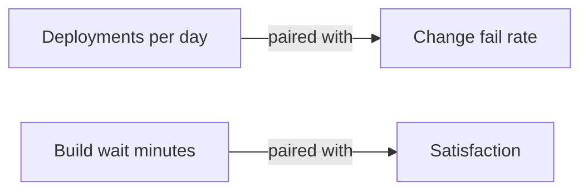

# Building A Balanced Metric Set

A team now knows five dimensions, three areas and several proxies. The last task is to choose a small set of metrics that tells the truth and does not harm the people measured. This part gives the rules for a balanced set, explains why individual-level activity metrics are a bad choice, and shows how to check a catalogue against the rules.

## Rules for a balanced set

A good set follows a few rules:

1. It takes measures from more than one SPACE dimension, and it includes at least one perceptual measure.
2. It pairs a measure that can be pushed with a measure that shows harm. Deployments per day is paired with change fail rate, so that speed bought with failures is visible.
3. It reports at the level of a team, a service or the whole organisation.
4. It states for each metric what decision the number supports.
5. It has few metrics. A set of five to eight measures that people understand is better than a wall of fifty.

A metric that supports no decision is removed. Collecting it still costs money and gives a reason to argue.

## Why individual activity metrics harm

The catalogue has two individual-level metrics: commits per developer and lines of code per developer. They are activity counts on a person. Work in software is shared: one developer helps another, reviews, pairs and writes documentation, and none of that appears in a personal commit count. A person measured on commits makes smaller commits. A person measured on lines writes longer code.

Individual measures also damage trust. Developers who think that surveys and metrics decide their pay may answer surveys with the answer that is safe, not the true one, and then the perceptual data becomes useless. The platform team states in writing that the data is used for the system and for teams, and not to rank people.

<!-- astrona:playground:renew -->

Save the catalogue if you do not have it:

```sh
kubectl -n metrics get configmap metric-catalogue -o json | jq -r '.data["metrics.json"]' > metrics.json
```

List the individual-level metrics:

```sh
jq -c '[.[] | select(.level == "individual") | .metric]' metrics.json
```

The output is `["commits per developer","lines of code per developer"]`. Both are activity metrics. Remove them and count what is left in each dimension:

```sh
jq -c '[.[] | select(.level == "team")] | group_by(.dimension) | map({dimension: .[0].dimension, n: length})' metrics.json
```

The output is `[{"dimension":"activity","n":2},{"dimension":"communication","n":1},{"dimension":"efficiency","n":4},{"dimension":"performance","n":2},{"dimension":"satisfaction","n":2}]`. Activity falls from four to two. The thinnest dimension is communication with one metric.

Count the team-level measures by type:

```sh
jq -c '[.[] | select(.level == "team")] | group_by(.measure) | map({measure: .[0].measure, n: length})' metrics.json
```

The output is `[{"measure":"perceptual","n":3},{"measure":"workflow","n":8}]`. Three of eleven team-level metrics come from asking people. The rule asks for at least one, and this set meets it, but a team that adds communication metrics should favour a perceptual one.

## Pairing in practice

The data in `team-measurements` shows why pairing matters. List the teams with their deployments per day and change fail rate:

```sh
kubectl -n metrics get configmap team-measurements -o json | jq -c '.data["teams.json"] | fromjson | .[] | {team, deployments_per_day, change_fail_rate}'
```

The team `shuttle` deploys 5.5 times a day, which is the most, and its change fail rate is 31 percent, which is the highest. Read alone, the deployment count praises the team. Read with the fail rate, it shows that speed comes with harm. The pair is the reason for the rule.



The diagram shows two pairs: one speed measure with a quality measure and one workflow measure with a perceptual one.

## Using the set

The platform team publishes the set, the definitions and the decisions each metric supports. It reviews the set every year and removes metrics that were never used. It looks at trends within a team more than at comparisons between teams, because teams differ in size, age of code and kind of work.

## What you know now

A balanced metric set covers several SPACE dimensions, includes perceptual data, pairs measures that can be pushed with measures that show harm and reports at the team level. Individual activity counts are left out because they are gamed and damage trust. The catalogue in the playground shows where a set is thin and how a pair exposes a hidden cost.

## Common pitfalls

> [!WARNING]
> Do not rank individual developers with activity counts. Do not publish a metric without the decision it supports. Do not compare teams of different kinds with the same target.
