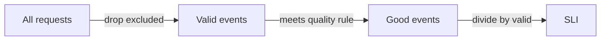

# Service Level Indicators For A Platform

A platform team that says "the platform is reliable" has said nothing a reader can check. To measure reliability, the team first needs a number that describes what a user of the platform experiences. This part defines that number, the service level indicator, and shows how to compute it from event counts.

## What a service level indicator is

A **service level indicator (SLI)** is a measurement of one aspect of a service, written as the share of events that were good. The general form is:

```
SLI = good events / valid events x 100
```

A **valid event** is one request or one operation that counts for the measure. A **good event** is a valid event that met the quality rule, for example a request that returned a success status within one second. The result is a percentage between 0 and 100. Because every SLI has the same form, a team can compare indicators of very different services.

## Choose indicators that users feel

The users of a platform are developers and their pipelines. They feel a request that fails or hangs, a pipeline that cannot start and an environment that never becomes ready. A good SLI therefore counts events at the point where the user meets the service, not inside a single server. Four kinds of indicator cover most platform services:

- **Availability:** the share of requests that return a non-error response. For the provisioning API this is the share of requests that do not return a server error.
- **Latency:** the share of requests that finish faster than a threshold. A threshold is better than an average, because an average hides the slow requests that users remember.
- **Freshness or correctness:** the share of operations whose result is right, for example the share of environments that are ready with the requested configuration.
- **Throughput of a job:** the share of pipeline runs that start within a set time after a commit.

An indicator such as CPU use of a server is a resource measure. It can explain a problem, but it is not an SLI, because a user does not feel it directly.

## A worked example

The playground holds the events of four platform services over 30 days. Each record has the total events, the good events and an SLO target. Save the data and compute the SLI of every service.

<!-- astrona:playground:renew -->

Save the data:

```sh
kubectl -n metrics get configmap service-events -o json | jq -r '.data["services.json"]' > services.json
```

Compute the SLI for each service:

```sh
jq -c '.[] | {service, sli: (.good_events * 100 / .total_events)}' services.json
```

The output has one line for each service. The `provisioning-api` has an SLI of 99.7, the `pipeline-runner` 99.4, the `portal` 99.95 and the `artifact-registry` 99.89. Each value is the good events divided by the total events, times 100. The gap of 0.3 points between 99.4 and 99.7 looks small, but it can decide whether a service met its objective.

## Where the events come from

The platform needs a reliable source of events. Three sources are common. A load balancer or API gateway log counts every request and its status. A metrics system such as Prometheus counts requests in counters, with one label for the status, and a query divides the good counter by the total counter. A synthetic probe sends a test request at a fixed interval, which works for a service with little traffic but counts only what the probe does.

Each source has a blind spot. A server-side count does not see a request that never arrived. A probe does not see a failure that only affects some users. A team states the source with the SLI, so that a reader knows what the number covers.

## Excluding events that do not count

Not every request is valid. A request that fails because the caller sent a malformed body is the caller's mistake, and counting it as bad lowers the SLI for a fault the platform did not cause. A team lists the rules for valid events in advance: which status codes count as bad, which paths are excluded (for example a health check path), and which callers are excluded (for example a load test). Changing these rules after seeing the data is a way to make a number look better, so the team records them with the SLI.



The diagram shows that the SLI is computed from valid events, and the quality rule splits them into good and bad.

## What you know now

An SLI is good events divided by valid events, measured where the user meets the service. Availability, latency, correctness and job timeliness cover most platform services. The source of the events and the rule for valid events belong to the definition. The open question is how good the SLI must be, which needs a target.

## Common pitfalls

> [!WARNING]
> Do not use an average latency as an SLI. Do not count resource use of a server as an indicator. Do not change the rule for valid events after you see the result.
