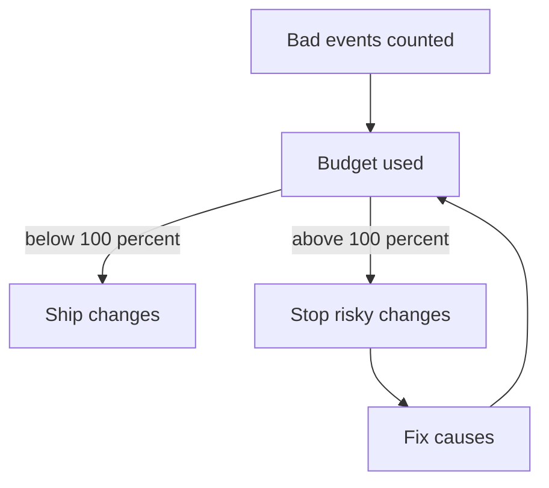

# Error Budgets And Budget Policy

A target of 99.5 percent also says that 0.5 percent of events may fail. That allowance is useful: it is the amount of unreliability the team can spend on changes, experiments and maintenance. This part turns the allowance into an error budget, computes how much of it a service has used, and shows the policy that links the budget to decisions.

## What an error budget is

An **error budget** is the number of bad events (or minutes of failure) that an SLO allows in its window. It equals one minus the target, applied to the valid events. A service that has used none of its budget has had no failures. A service that has used all of it has reached its SLO limit. A service that has used more than all of it has missed the SLO.

The budget changes the question from "was there a failure?" to "can we afford the next risk?". A deployment, a migration or a chaos test can cause failures. If the budget is large, the team ships faster. If it is nearly gone, the team slows down and invests in reliability.

## Computing the share of budget used

The share of budget used is the bad events divided by the allowed bad events:

```
budget used = bad events / allowed bad events x 100
```

<!-- astrona:playground:renew -->

Save the data if you do not have it:

```sh
kubectl -n metrics get configmap service-events -o json | jq -r '.data["services.json"]' > services.json
```

Compute the share for every service:

```sh
jq -c '.[] | {service, used_percent: ((.total_events - .good_events) / (.total_events * (100 - .slo_target_percent) / 100) * 100)}' services.json
```

The `provisioning-api` used 600 of 1000 allowed bad events, which is 60 percent. The `pipeline-runner` used 300 of 250, which is 120 percent. The `portal` used 50 of 100, which is 50 percent, and the `artifact-registry` used 110 of 100, which is 110 percent. The output may show tiny rounding differences after the decimal point for some values, because `jq` uses floating-point numbers. Round when you report.

Two services are over budget. The `pipeline-runner` is further over, so it has the largest share. Notice that its SLI of 99.4 percent is also the lowest, but that ranking can differ when targets differ: a service with a strict target can use more budget with a better SLI than a service with a loose target.

## A budget policy

A **budget policy** is a written rule that says what the team does at each level of budget use. It is agreed in advance by the platform team and its stakeholders, so nobody has to argue during an incident. A simple policy has three levels:

| Budget used | Action |
| --- | --- |
| Below 50 percent | Normal work. Ship changes at the usual pace. |
| 50 to 100 percent | Take care. Review risky changes more closely and prioritise fixes for the causes of failures. |
| Above 100 percent | Stop risky changes. Work on reliability until the service is back within its budget. |

Under this policy, `portal` is at the edge of normal work and `provisioning-api` is in the care level. The `pipeline-runner` and the `artifact-registry` are above 100 percent, so they stop risky changes. A stop does not stop security fixes or changes that improve reliability. The policy needs a named owner who can enforce it, usually the product owner of the platform, or it is ignored.

## What counts against the budget

Not every bad event has the same cause. Failures from a deployment, from a dependency, from a capacity limit and from planned maintenance can all count. A team decides which ones count and writes it down. Excluding planned maintenance is common if users were told in advance, but excluding too much makes the budget meaningless. The platform team looks at the largest causes of used budget and fixes those first.

## The budget is also a signal for too much reliability

A service that uses almost none of its budget may be too reliable for its target. That is not a success; it means the team is slowing delivery for no gain, or that the target is too loose to matter. The team can then ship faster, or move its effort to a service that is over budget.



The diagram shows that the budget used decides whether the team ships or fixes, and that fixing lowers the next measurement.

## What you know now

An error budget is the number of bad events that the SLO allows. The share used is bad events divided by allowed bad events, and a budget policy turns that share into actions that the team agreed on before the failure. The open question is how to see budget use early enough to act, which needs a rate of use.

## Common pitfalls

> [!WARNING]
> Do not report the budget used without the window and the target. Do not enforce a stop policy that nobody owns. Do not treat a service that uses none of its budget as a perfect result.
