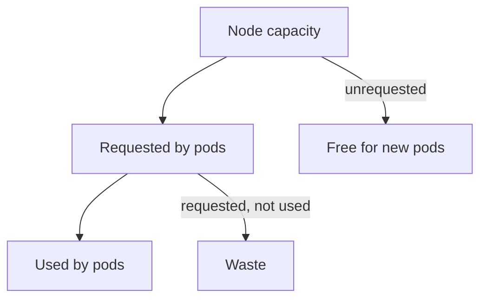

# Resource Requests, Usage And Utilization

The cost of a Kubernetes cluster follows the machines the cluster runs on, and the machines follow what the pods ask for. A platform team that wants to measure efficiency first needs to know the difference between what a pod asks for and what it uses. This part defines the terms and computes utilization from team data.

## Requests, limits and usage

A Kubernetes **resource request** is the amount of CPU or memory a container asks for. The **scheduler** (the control plane component that picks a node for each pod) places a pod only on a node that has the requested amount free. A **resource limit** is the maximum a container may use: CPU above the limit is slowed down, and memory above the limit kills the container. **Usage** is what the container really uses at a moment, measured by the metrics pipeline.

CPU is measured in cores. One **millicore** is one thousandth of a core, so 500m means half a core. The request reserves capacity whether or not the container uses it. A pod that requests 2000m and uses 200m still blocks 2000m from other pods, and the cluster owner pays for the node that holds it.

## What utilization is

**Utilization** is usage divided by the request, written as a percentage:

```
utilization = used / requested x 100
```

A low value means that the team asks for more than it needs. A value near 100 means that the pod has no headroom, and a spike can slow it down. Neither extreme is the goal. A practical range for a steady service is 40 to 70 percent, which leaves room for peaks. The number depends on the kind of workload: a batch job can run near 100 percent, and a service with sudden traffic needs more room.

## Reading team data

The playground holds the data of four teams for one month. For each team the ConfigMap has the CPU requested, the average CPU used, the monthly cost of the team's environments, the number of environments and how many of them were idle.

<!-- astrona:playground:renew -->

Save the data:

```sh
kubectl -n metrics get configmap team-resources -o json | jq -r '.data["teams.json"]' > teams.json
```

Compute the utilization of each team:

```sh
jq -c '.[] | {team, requested: .cpu_requested_millicores, used: .cpu_used_millicores, utilization: (.cpu_used_millicores * 100 / .cpu_requested_millicores)}' teams.json
```

The output shows utilization 25 for `bridge` (2000 used of 8000 requested), 75 for `scout`, 15 for `shuttle` (900 of 6000) and 75 for `probe`. Two teams ask for far more than they use. Two teams are close to a healthy range, and the `scout` and `probe` teams may even have little headroom for peaks.

## Fleet utilization

The platform team also wants one number for the whole fleet. The right way is to add the usage of all teams and divide it by the sum of all requests. An average of the four percentages would give a different number, because it treats a small team and a large team equally.

```sh
jq '(map(.cpu_used_millicores) | add) * 100 / (map(.cpu_requested_millicores) | add)' teams.json
```

The output is `37`. The fleet requests 20000 millicores and uses 7400. The simple average of the four percentages is 47.5, which looks better than the truth because the small, efficient teams count as much as the large, wasteful ones.

## Averages hide peaks

The usage here is an average over the month. A service with a daily peak of 4000m and a nightly use of 200m can have an average of 900m. Sizing the request to the average would starve it at the peak. A team therefore also looks at a high percentile of usage, such as the 95th, when it chooses a request. This module uses averages because the data is simple. The idea to keep is that utilization depends on what period and what statistic you measure.



The diagram shows that the cost of a node covers the requested part, and that the part that is requested but not used is waste.

## What you know now

A request reserves capacity, a limit caps use, and utilization is usage divided by the request. Fleet utilization is computed from sums, not from an average of percentages, and a monthly average can hide peaks. The open question is how to turn these cores into money, which needs cost allocation.

## Common pitfalls

> [!WARNING]
> Do not average utilization percentages across teams of different size. Do not size requests to a monthly average only. Do not treat 100 percent utilization as the goal.
