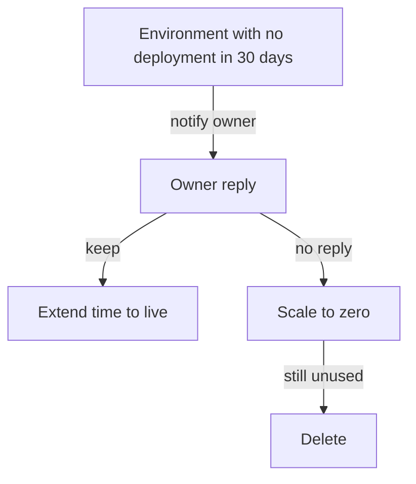

# Waste, Idle Environments And Rightsizing

Some of the cost of a platform buys capacity that nobody uses. A platform team can find this waste with the same data it uses for utilization, but it must measure waste in the right unit. This part computes waste in cores and in money, finds idle environments and explains rightsizing.

## Two kinds of waste

Waste appears in two forms. **Over-provisioning** is capacity that a workload requests and does not use. **Idle environments** are environments that exist and cost money but have no activity, such as a test environment for a feature branch that was merged weeks ago. The first is found from utilization and the second from activity such as the last deployment date.

## Waste in cores and waste in money

Wasted CPU is the request minus the usage. It is measured in millicores. A team with a large number of wasted millicores is not always the team that wastes the most money, because the price of a core differs between teams. A team whose environments use expensive nodes or extra services pays more for each wasted core.

The waste cost is the monthly cost times the wasted share of the request:

```
waste cost = monthly cost x (requested - used) / requested
```

<!-- astrona:playground:renew -->

Save the data if you do not have it:

```sh
kubectl -n metrics get configmap team-resources -o json | jq -r '.data["teams.json"]' > teams.json
```

Compute both kinds of waste for each team:

```sh
jq -c '.[] | {team, wasted_millicores: (.cpu_requested_millicores - .cpu_used_millicores), waste_cost: (.monthly_cost * (.cpu_requested_millicores - .cpu_used_millicores) / .cpu_requested_millicores)}' teams.json
```

The wasted CPU is 6000 millicores for `bridge`, 1000 for `scout`, 5100 for `shuttle` and 500 for `probe`. The waste cost is 1200 dollars for `bridge`, 225 for `scout`, 1275 for `shuttle` and 125 for `probe`. The team with the most wasted cores is `bridge`, but the team with the highest waste cost is `shuttle`. The answer depends on the unit, and a report must say which unit it uses. The total waste cost is 2825 dollars of the 4500 dollars the teams spend.

## Idle environments

An idle environment is a clear target: nobody uses it, so removing it harms nobody if the owner agrees. The data records for each team how many environments had no deployment in 30 days. The cost of idle environments is the cost per environment times the number of idle ones.

```sh
jq -c '.[] | {team, idle: .idle_environments, idle_cost: (.monthly_cost / .environments * .idle_environments)}' teams.json
```

The `bridge` has one idle environment at 200 dollars and `shuttle` has three at 250 dollars each, which is 750 dollars. The other two teams have none. The idle cost is 950 dollars for the month. Notice that this overlaps with the waste cost: an idle environment also has low utilization, so the two numbers must not be added together.

## Rightsizing

**Rightsizing** means changing requests to match real use plus headroom. The usual rule is to set the request near a high percentile of usage with some margin. In Kubernetes, the Vertical Pod Autoscaler can recommend request values from history. A team can also apply them by hand.

Suppose `shuttle` reduces its request to twice its use, which is 1800 millicores. Its utilization becomes 50 percent. If cost falls in proportion to the request, its monthly cost falls from 1500 to 450 dollars. That assumption is rough: nodes are bought in whole units, so cost falls only when enough pods leave to free a node. The platform team uses the cluster autoscaler or node consolidation to turn smaller requests into smaller bills.

## Safe actions on idle environments

The platform team does not delete an environment because a number says it is idle. The safe way is to notify the owner, set a time limit, shut the environment down first and delete it later if nobody objects. A platform can also add a default time to live to every temporary environment, so waste is prevented instead of cleaned up.



The diagram shows a staged removal of an idle environment, where each step can be reversed until the last one.

## What you know now

Waste is capacity that is requested but not used, and environments that nobody uses. It must be measured in a stated unit, because the largest waste in cores and the largest waste in money can belong to different teams. Idle cost and waste cost overlap. Rightsizing and a default time to live reduce waste, and removal follows a safe process. The open question is how to report all of this to people who decide.

## Common pitfalls

> [!WARNING]
> Do not add idle environment cost to waste cost. Do not rank teams by wasted cores when you report money. Do not delete an idle environment without telling its owner.
