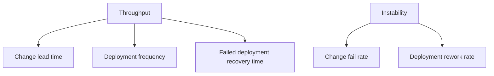

# The Five Delivery Metrics

A platform team improves how software gets from a developer to production, and it needs a way to tell whether the delivery got better. DORA, the DevOps Research and Assessment programme, studies software delivery performance with survey and data research. It publishes a small set of metrics that describe two things: how fast and often changes reach production, and how stable the delivery is. This part defines each metric exactly and says which event it needs.

## Two groups: throughput and instability

The DORA model uses five metrics in two groups. **Throughput** measures how quickly and how often a team delivers changes. The throughput metrics are change lead time, deployment frequency and failed deployment recovery time. **Instability** measures how often a delivery goes wrong and needs more work. The instability metrics are change fail rate and deployment rework rate.

The groups exist because speed and stability are two separate questions. A team can deploy often and fail often, or deploy rarely and fail rarely. Reading one group alone gives half of the picture, and the research reports both groups to avoid the belief that speed and stability must be traded against each other.

## The definitions

**Change lead time** is the time from a change being committed to version control until it is deployed in production. A change is one unit of work that reaches production, such as a commit or a merged pull request. The metric needs two timestamps for each change: the commit time and the deployment time.

**Deployment frequency** is the number of deployments to production in a period, or the time between deployments. It needs a count of production deployments and a period.

**Failed deployment recovery time** is the time it takes to recover from a deployment that fails and needs immediate intervention. It needs the time of the failed deployment and the time of the recovery. Earlier material called this metric time to restore service, or mean time to recovery (MTTR). The current name ties the measure to a failed deployment instead of any incident.

**Change fail rate** is the share of deployments that need immediate intervention after the deployment. Immediate intervention means a rollback, a hotfix, a manual step or a patch that the team cannot postpone. The metric needs the total number of deployments and the number of those that needed intervention.

**Deployment rework rate** is the share of deployments that were unplanned and happened because of an incident in production. It counts the extra deployments a team makes to repair something. It needs a way to mark a deployment as unplanned rework.



The diagram shows the two groups and the three and two metrics that sit under them.

## Which events a team needs

Every metric comes from two kinds of event. The first is a change record with its commit time. The second is a deployment record with its time, its target (production) and its result. A deployment that needs intervention also needs a recovery time. The data usually comes from the version control system, the delivery pipeline and the incident tooling.

The platform's part in this is to make the events exist and be trustworthy. A pipeline that records every production deployment with the commit it carried gives lead time and frequency without manual work. A deployment record that carries an identifier, a service and a result makes the instability metrics possible.

## The example data

The playground holds the deployments of a service named `shuttle-api` for 10 days, from 2026-10-05 to 2026-10-14. The ConfigMap `deployments` in the namespace `delivery` stores 20 records as a JSON array. Each record has `committed_at` and `deployed_at` as UTC timestamps, `needed_intervention` and `unplanned_rework` as booleans, and, for failed deployments only, `recovered_at`.

<!-- astrona:playground:renew -->

Read the data into a local file:

```sh
kubectl -n delivery get configmap deployments -o json | jq -r '.data["deployments.json"]' > deployments.json
```

Look at one ordinary deployment, the first record:

```sh
jq -c '.[0]' deployments.json
```

The output is `{"id":"d01","service":"shuttle-api","committed_at":"2026-10-05T06:00:00Z","deployed_at":"2026-10-05T10:00:00Z","needed_intervention":false,"unplanned_rework":false}`. The change was committed at 06:00 and deployed at 10:00, so its lead time is 4 hours. It did not need intervention.

Now look at the third record, a failed deployment:

```sh
jq -c '.[2]' deployments.json
```

The output is `{"id":"d03","service":"shuttle-api","committed_at":"2026-10-06T04:00:00Z","deployed_at":"2026-10-06T10:00:00Z","needed_intervention":true,"unplanned_rework":false,"recovered_at":"2026-10-06T10:20:00Z"}`. It was deployed at 10:00 and the service recovered at 10:20, so its recovery time is 20 minutes. This record has `recovered_at` and the first one does not.

## Counting deployments

Count the deployments and the days. Deployment frequency is the count divided by the days of the window:

```sh
jq 'length' deployments.json
```

The answer is `20`. The window has 10 days, so the frequency is 2 deployments per day, or 14 per week. The window is part of the definition. A frequency without a period is not a measurement, and a window that includes holidays gives a lower figure than a working window of the same length.

## Rework is not the same as failure

The two instability metrics count different sets of deployments. A failed deployment is one that needed immediate intervention after it was made. A rework deployment is an extra deployment made to repair a production incident. Compare the two sets by id:

```sh
jq -c '[.[] | select(.needed_intervention) | .id]' deployments.json
jq -c '[.[] | select(.unplanned_rework) | .id]' deployments.json
```

The first list is `["d03","d08","d11","d15","d18"]` and the second is `["d09","d16"]`. The deployments `d09` and `d16` repair the failures `d08` and `d15`. Rework is the repair work that follows, and it does not repeat the failure it repairs. A team that fixes a failure by a rollback may have no rework deployment at all.

## What you know now

The five metrics split into throughput (change lead time, deployment frequency, failed deployment recovery time) and instability (change fail rate, deployment rework rate). Each needs a defined event, a timestamp and a window. The metrics are about a service, and they need data that the delivery pipeline can record. The open question is how to turn the events into numbers in a way that does not mislead.

## Common pitfalls

> [!WARNING]
> Do not report deployment frequency without its period. Do not count a rework deployment as a failed one, or the reverse. Do not use the old name MTTR for the current metric without saying that the definition now starts at a failed deployment.
