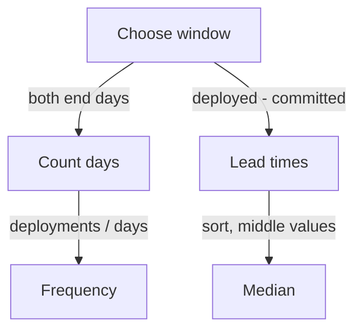

# Windows, Medians And Edge Cases In Deployment Data

Two people can compute the deployment frequency from the same events and get different numbers. The difference usually comes from the window they chose, the way they counted days or the statistic they used. This part shows the decisions that must be stated for every metric and walks through the edge cases that cause wrong numbers.

## State the window, the statistic and the unit

A metric value has four parts: the data it covers, the window, the statistic and the unit. "Lead time is 6 hours" is incomplete. "The median change lead time of `shuttle-api` from 5 to 14 October 2026 was 6 hours, from 20 deployments" is complete.

The **window** is the period of the deployments. A short window reacts fast and is noisy. A long window is stable and slow to show a change. The window must be the same when two periods are compared.

## Counting days

The example data covers 10 days from 2026-10-05 to 2026-10-14, counted from the first day to the last day, both included.

<!-- astrona:playground:renew -->

Save the data from the ConfigMap:

```sh
kubectl -n delivery get configmap deployments -o json | jq -r '.data["deployments.json"]' > deployments.json
```

Count the deployments for each day:

```sh
jq -c 'group_by(.deployed_at[0:10]) | map({day: .[0].deployed_at[0:10], n: length})' deployments.json
```

The output has 10 entries, one for each day from 2026-10-05 to 2026-10-14, and each day has 2 deployments. The deployment frequency is 20 deployments in 10 days, which is 2 per day. If the window had been written as 9 days, because the last day is one day after the first day, the result would be 2.2 per day. The report states that both end days are included.

A window can also contain days with no deployment. If a service deployed only on weekdays and the window includes a weekend, the average per calendar day is lower than the average per working day. State which day count is used.

## Lead time and the even median

Compute the lead time of every deployment in hours and sort the values:

```sh
jq -c '[.[] | ((.deployed_at | fromdateiso8601) - (.committed_at | fromdateiso8601)) / 3600] | sort' deployments.json
```

The output is `[2,3,3,4,4,5,5,5,6,6,6,7,7,8,9,10,12,26,30,48]`. The function `fromdateiso8601` turns a timestamp into seconds, so the difference is divided by 3600 to give hours. There are 20 values. For an even count, the median is the average of the two middle values, which are the 10th and the 11th. Both are 6, so the median is 6 hours. Verify it:

```sh
jq -c '[.[] | ((.deployed_at | fromdateiso8601) - (.committed_at | fromdateiso8601)) / 3600] | sort | (.[9] + .[10]) / 2' deployments.json
```

The output is `6`. The mean of the same values is 10.3 hours. The three slowest changes took 26, 30 and 48 hours and pull the mean up. The median describes the typical change and the report can add the 90th percentile to describe the slow ones.

## Edge cases

- **An empty window.** A window with no deployments has no median. The correct value is "no data", not 0 hours.
- **No failures.** A window without failed deployments has a change fail rate of 0 percent, but the failed deployment recovery time has no value. It is not 0 minutes.
- **A very small count.** With three deployments, one failure gives a change fail rate of 33 percent. The report shows the count.
- **Mixed units.** Lead time in hours and recovery in minutes must be labelled. A report that mixes them confuses readers.
- **Time zones.** Timestamps are stored in UTC. A day boundary in a local time zone moves deployments between days.



The diagram shows that the window feeds both the frequency and the lead time median.

## What you know now

A metric value needs a window, a statistic, a unit and a count. The deployment frequency depends on how days are counted, the median of an even count is the average of the two middle values and some windows have no value. The open question is how to decide what a deployment, a failure and a recovery are in the first place.

## Common pitfalls

> [!WARNING]
> Do not report 0 minutes of recovery time for a window with no failures. Do not compare two windows of different length without saying so. Do not average a median of an even count by taking one of the middle values.
