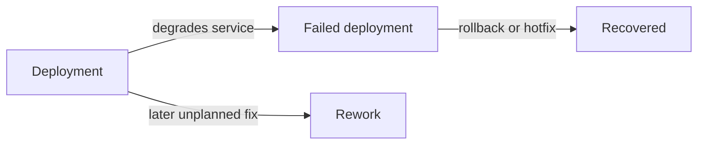

# Defining Deployment, Failure And Recovery In Deployment Events

The five metrics depend on three definitions: what a deployment is, what a failure is and when recovery starts and ends. Teams that use different definitions produce numbers that cannot be compared. This part uses the example events to show how the definitions work and how a failed deployment differs from a deployment that needed rework.

## What counts as a deployment

A **deployment** is a change that reaches the production environment and is available to users. Releases to a test environment do not count. A deployment of a feature that is turned off by a feature flag counts as a deployment, but the team should say that it does. A rollback is a deployment too, but it is recorded as part of the recovery of a failure and not as a new change.

Each record in the example data has `committed_at` and `deployed_at`, which are the start and the end of the change lead time, and the two flags `needed_intervention` and `unplanned_rework`.

## Failed deployment and rework

A **failed deployment** is a deployment that degraded the service and needed an intervention, such as a rollback or a hotfix. The flag `needed_intervention` marks it. The **deployment rework rate** counts deployments that were followed by an unplanned deployment, made to fix a user-facing problem in the earlier one. The flag `unplanned_rework` marks them. The two sets can be different.

<!-- astrona:playground:renew -->

Save the data from the ConfigMap if you do not have the file:

```sh
kubectl -n delivery get configmap deployments -o json | jq -r '.data["deployments.json"]' > deployments.json
```

List the ids in each set:

```sh
jq -c '[.[] | select(.needed_intervention) | .id]' deployments.json
jq -c '[.[] | select(.unplanned_rework) | .id]' deployments.json
```

The output is `["d03","d08","d11","d15","d18"]` and `["d09","d16"]`. The two sets have no common id. Five deployments failed, so the change fail rate is 5 out of 20, which is 25 percent. Two deployments caused rework, so the rework rate is 10 percent. A deployment can need rework without failing, and failing without rework. Seven deployments were in at least one set, and counting them as one number would hide the difference between the two metrics.

## Recovery: start and end

The **failed deployment recovery time** is the time from the failed deployment until the service is restored. The start is `deployed_at`. The end is `recovered_at`, which the team sets when the service is back to normal. A failure that is found late still starts at the deployment, so the metric includes the time to detect it. Only failed deployments have a recovery time.

Compute the recovery time of every failed deployment in minutes:

```sh
jq -c '[.[] | select(.needed_intervention) | {id, minutes: (((.recovered_at | fromdateiso8601) - (.deployed_at | fromdateiso8601)) / 60)}]' deployments.json
```

The output is `[{"id":"d03","minutes":20},{"id":"d08","minutes":90},{"id":"d11","minutes":35},{"id":"d15","minutes":300},{"id":"d18","minutes":50}]`. Sorted, the five values are 20, 35, 50, 90 and 300. The median is the middle value, 50 minutes. The mean is 99 minutes, pulled up by the 300 minutes of `d15`. Taking the median over all 20 deployments, including those that did not fail, would be a mistake, because the 15 healthy deployments have no recovery.

## Decisions to write down

The platform team writes down answers to these questions and uses them in every service:

- Which environment is production, and are staged rollouts one deployment or many?
- What event sets `needed_intervention`: a rollback, a hotfix, a manual change in production or an incident?
- Who sets `recovered_at`, and from which signal, for example an alert that returns to normal?
- How is a rollback recorded: as the recovery of the failed deployment, not as a new deployment?
- Is a hotfix that fixes a failure counted as rework or as part of the recovery of the failure?

The last question shows why the definitions matter: a hotfix that repairs a failed deployment is part of its recovery, and a fix that repairs a problem of a deployment that was not marked as failed is rework.



The diagram shows two ways a deployment can lead to more work: as a failure that needs recovery, or as a problem that needs a later fix.

## What you know now

A deployment reaches production, a failed deployment needs an intervention and a deployment with rework is followed by an unplanned fix. The recovery time starts at the deployment and ends when the service is restored, and it is computed over failed deployments only. With written definitions, the numbers of different services can be compared.

## Common pitfalls

> [!WARNING]
> Do not merge failed deployments and rework into one count. Do not start the recovery time at the moment of detection. Do not compute the recovery median over deployments that did not fail.
