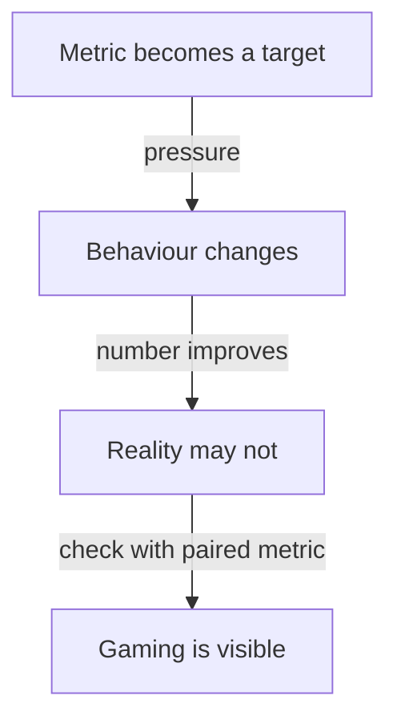

# Gaming And Healthy Use Of Delivery Metrics

Delivery metrics are useful until people are judged by them. At that point they start to change what people do, and not always for the better. This part shows how each of the metrics can be gamed, calculates the effect of one case and gives rules that keep the numbers useful.

## Goodhart's law

**Goodhart's law** says that when a measure becomes a target, it stops being a good measure. A team that is told to raise the deployment frequency can raise it without delivering more value. The number goes up and the underlying reality does not change.

## How each metric can be gamed

| Metric | A way to game it | What the numbers then show |
| --- | --- | --- |
| Deployment frequency | Split one change into many small or empty deployments | Frequency rises, value does not |
| Change lead time | Start the clock at the pull request instead of the first commit | Lead time falls, delivery does not |
| Change fail rate | Do not record failures, or call them planned work | The rate falls, users still suffer |
| Failed deployment recovery time | Close the incident early | Recovery looks short |
| Deployment rework rate | Fix problems inside the next planned change | Rework disappears from the record |

None of these requires bad intent. A team under pressure to improve a number takes the shortest path to the number.

## A worked example

The example data holds a before and an after state for three services. Look at `scout-api`:

<!-- astrona:playground:renew -->

Save the data from the ConfigMap:

```sh
kubectl -n delivery get configmap service-metrics -o json | jq -r '.data["metrics.json"]' > service-metrics.json
```

Compute the number of failed deployments per week before and after, from the deployments per week and the change fail rate:

```sh
jq -c '.[] | {service, failed_before: (.before.deploys_per_week * .before.change_fail_rate_percent / 100), failed_after: (.after.deploys_per_week * .after.change_fail_rate_percent / 100)}' service-metrics.json
```

The output has three lines. For `scout-api` the failed deployments per week rise from 0.2 to 2, a tenfold increase. For `probe-api` they rise from 0.6 to 1.2. For `drifter-api` they rise from 0.3 to 0.4. The change fail rate of `scout-api` doubled from 10 to 20 percent, and the deployments per week rose from 2 to 10. The service now fails 2 deployments each week, where before it failed one every five weeks. A report that highlights the fivefold rise in deployments per week and the drop in lead time from 48 to 8 hours, and leaves out the failures, is correct in each number and misleading as a whole.

Now suppose the team split every deployment in two without any other change. The deployments per week would double to 20 and the fail rate per deployment would not change. The metric would show a gain from nothing. Only the count of deployments, in combination with failures and rework, can reveal this.

## Rules that keep the numbers honest

1. **Use the metrics to learn, not to rank.** Do not set a target for each team or tie the numbers to pay.
2. **Read both groups together.** Throughput measures need instability measures next to them.
3. **Keep the definitions fixed** and collect the data automatically from the pipeline, so that people cannot edit it.
4. **Look at the records behind a number** when it changes a lot. A tenfold increase in failures has an explanation in the events.
5. **Let teams choose their own improvement goals** based on the numbers, and review them in conversation.



The diagram shows how a target changes behaviour and how a paired metric makes the gaming visible.

## What you know now

Every delivery metric has a cheap way to improve the number without improving delivery. The protection is to avoid targets and rankings, to read throughput and instability together, to collect data automatically and to look at the records behind a large change. In the example data, a service with higher throughput also fails ten times as many deployments each week.

## Common pitfalls

> [!WARNING]
> Do not report a gain in one metric without the metrics that might have worsened. Do not tie delivery metrics to pay or ranking. Do not let teams enter the metric values by hand.
