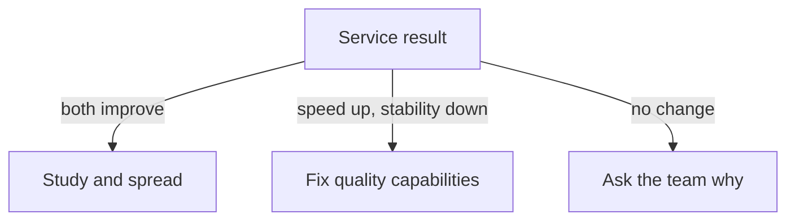

# Throughput And Instability Trade-Offs In Platform Initiatives

A platform initiative, such as a new deployment pipeline, aims to help teams ship faster and more safely. The data after the change often shows a mixed picture. This part describes how to read a mixed picture, how to decide whether the initiative worked and what to do next.

## Four possible results

For one service, throughput can improve or not, and instability can improve or not. This gives four cases:

- Throughput improves and instability improves: the clearest success.
- Throughput improves and instability worsens: speed was bought with risk.
- Throughput does not improve and instability improves: more safety and no speed.
- Neither improves: the initiative did not help that service.

The platform team classifies each service, because an organisation-wide average puts all four cases into one number.

<!-- astrona:playground:renew -->

Save the data from the ConfigMap if you do not have the file:

```sh
kubectl -n delivery get configmap service-metrics -o json | jq -r '.data["metrics.json"]' > service-metrics.json
```

Print the before and after values of the metrics for each service:

```sh
jq -c '.[] | {service, uses_pipeline: .platform_pipeline, lead_hours: [.before.lead_time_hours, .after.lead_time_hours], deploys_per_week: [.before.deploys_per_week, .after.deploys_per_week], fail_rate: [.before.change_fail_rate_percent, .after.change_fail_rate_percent], rework_rate: [.before.rework_rate_percent, .after.rework_rate_percent]}' service-metrics.json
```

The output has three lines. For `scout-api`, the lead time falls from 48 to 8 hours, the deployments per week rise from 2 to 10, the fail rate rises from 10 to 20 percent and the rework rate rises from 5 to 15 percent. For `probe-api`, the lead time falls from 24 to 6 hours, the deployments rise from 4 to 12, the fail rate falls from 15 to 10 percent and the rework rate falls from 10 to 5 percent. For `drifter-api`, which does not use the pipeline, the lead time falls from 40 to 30 hours, the deployments rise from 3 to 4 and the fail and rework rates are unchanged.

## Reading the three services

`probe-api` is the clear success: throughput and instability both improved, and it uses the pipeline. `scout-api` is the trade-off case: throughput improved a lot and the failure and rework rates doubled and tripled. The pipeline made it easy to ship, and something about the quality of what is shipped got worse. The next step for `scout-api` is not to remove the pipeline. It is to look at the failures and to add the capabilities that reduce them, such as automated tests or progressive delivery.

`drifter-api` did not use the pipeline and still improved its lead time from 40 to 30 hours. Something else helped it: a smaller backlog, a changed team or a different change. This weakens any claim that the pipeline alone explains the improvements, because the same period contains improvement without the pipeline. It does not show that the pipeline had no effect on the other two services. It means the comparison between pipeline users and the service that did not use it is not clean.

## Blended averages hide the cases

Compute the average lead time of the two pipeline services:

```sh
jq -c 'map(select(.platform_pipeline)) | {before: (map(.before.lead_time_hours) | add / length), after: (map(.after.lead_time_hours) | add / length)}' service-metrics.json
```

The output is `{"before":36,"after":7}`. The average falls from 36 to 7 hours, a drop of 81 percent. This would be an attractive number in a presentation, and it combines a service that got less stable with a service that improved on every measure. A report that gives one blended number removes the information that the team needs for its next decision.

## Deciding what to do next

The platform team makes a short statement for each service: what improved, what got worse and what is not known. Then it chooses an action. For `scout-api`, it investigates the failures with the team and measures again after a change. For `probe-api`, it studies what the team did and checks if other teams can copy it. For `drifter-api`, it asks what helped and whether the pipeline would add anything.



The diagram shows a different follow-up action for each kind of result.

## What you know now

A platform initiative produces different results in different services. The report classifies each service by throughput and instability, avoids a blended average and says what the data does not prove. A service that improved without the initiative weakens a claim of cause. The result of this course is a habit: compute the metrics from events, report them with their definitions and read them with care.

## Common pitfalls

> [!WARNING]
> Do not report a blended average across services with different results. Do not remove a platform capability only because one service got less stable. Do not claim that the initiative caused an improvement that also happened without it.
