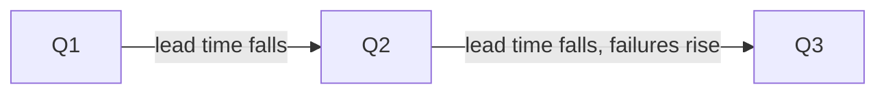

# Trends Over Time And Performance Profiles

One value of a metric says little. The useful question is whether the service is getting better or worse and by how much. This part computes the metrics for each quarter, reads the direction of each, and explains why a team compares itself with its own past and not with a ranking of other teams.

## Why a trend

A value is a snapshot. A change lead time of 37 hours means nothing without knowing the last quarter. The platform team computes each metric over a fixed window, for example a quarter, with the same definition, and puts the values side by side. The direction is what a platform initiative should change.

## Quarterly numbers

The windows must contain enough deployments. A quarter with two deployments gives a median that one record can change. The example quarters have 6, 8 and 10 deployments, and the report must show these counts.

<!-- astrona:playground:renew -->

Save the data from the ConfigMap if you do not have the file:

```sh
kubectl -n delivery get configmap deployment-history -o json | jq -r '.data["deployments.json"]' > deployments.json
```

Compute the median change lead time for each quarter. For an even count, the median is the average of the two middle values:

```sh
jq -c 'def med: sort | (length) as $n | if ($n % 2) == 1 then .[($n-1)/2] else (.[$n/2-1] + .[$n/2]) / 2 end; group_by(.quarter) | map({quarter: .[0].quarter, median_lead_hours: ([.[].lead_time_hours] | med)})' deployments.json
```

The output is `[{"quarter":"Q1","median_lead_hours":65},{"quarter":"Q2","median_lead_hours":37},{"quarter":"Q3","median_lead_hours":22.5}]`. The lead time fell in each quarter, from 65 to 37 to 22.5 hours. Q3 has 10 values: the sorted values are 18, 19, 20, 21, 22, 23, 24, 25, 26 and 30, and the median is the average of 22 and 23.

Now compute the change fail rate and the deployment rework rate for each quarter:

```sh
jq -c 'group_by(.quarter) | map({quarter: .[0].quarter, fail_rate: (([.[] | select(.failed)] | length) * 100 / length), rework_rate: (([.[] | select(.rework)] | length) * 100 / length)})' deployments.json
```

The output is `[{"quarter":"Q1","fail_rate":33.333333333333336,"rework_rate":50},{"quarter":"Q2","fail_rate":12.5,"rework_rate":25},{"quarter":"Q3","fail_rate":20,"rework_rate":20}]`. The fail rate fell from Q1 to Q2 and rose again in Q3, from 12.5 to 20 percent. The rework rate fell in each quarter.

Compute the median recovery time of the failed deployments in each quarter:

```sh
jq -c 'def med: sort | (length) as $n | if ($n % 2) == 1 then .[($n-1)/2] else (.[$n/2-1] + .[$n/2]) / 2 end; [.[] | select(.failed)] | group_by(.quarter) | map({quarter: .[0].quarter, median_recovery_minutes: ([.[].recovery_minutes] | med), failures: length})' deployments.json
```

The output is `[{"quarter":"Q1","median_recovery_minutes":210,"failures":2},{"quarter":"Q2","median_recovery_minutes":90,"failures":1},{"quarter":"Q3","median_recovery_minutes":222.5,"failures":2}]`. The recovery time was best in Q2 and worst in Q3. The values come from one, two or two failures, so a single long recovery of 400 minutes decides the Q3 median. The report must show the count of failures next to this number.



The diagram shows the situation in the data: lead time falls through all three quarters, but the instability metrics get worse from Q2 to Q3.

## Reading the profile

The picture has two sides. The throughput side improved: lead time fell by about 39 percent from Q2 to Q3 and the number of deployments rose from 8 to 10. The instability side got worse from Q2 to Q3: the fail rate rose and recovery slowed down. A report that shows only the first side calls Q3 a success. A report that shows both says that Q3 is faster and less stable, and that the team should find out why.

## Why not rank teams

DORA research groups teams into performance profiles by their metrics, and the groups help to see what is possible. A platform team does not use them to rank teams against one another. Teams run different products with different risks: a team with a payment system and a team with an internal report tool should not have the same targets. A ranking also gives teams a reason to change how they count. The comparison that stays fair is a service against its own past.

## What you know now

A report puts each metric next to its previous values with the same window and definition, and states the counts. In the data, lead time improved in every quarter while the fail rate and recovery time got worse in Q3. A team compares itself with its own history, not with a league table. The open question is what to do with a weak metric, which the next part addresses.

## Common pitfalls

> [!WARNING]
> Do not compute a median from a window with very few records without showing the count. Do not report the improving metrics and leave out the metrics that got worse. Do not rank teams with different products by the same numbers.
