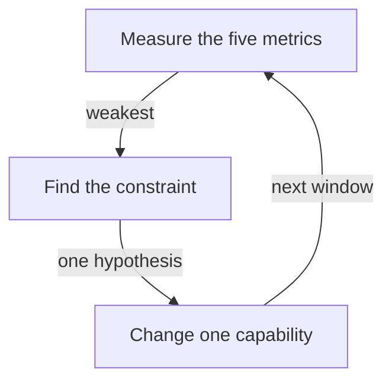

# Finding The Constraint And Improving It With The Platform

When the numbers show a weak spot, the platform team must decide what to change. Changing everything at once makes it impossible to learn what worked. This part shows how to find the weakest metric, name its likely causes and match them to platform capabilities.

## Find the constraint first

A **constraint** is the part of the delivery process that limits the whole. The DORA research recommends improving the biggest constraint first and measuring again. In the example data, lead time is falling and the instability metrics are rising in Q3, so the constraint has moved from speed to stability.

<!-- astrona:playground:renew -->

Save the data from the ConfigMap if you do not have the file:

```sh
kubectl -n delivery get configmap deployment-history -o json | jq -r '.data["deployments.json"]' > deployments.json
```

Look at the Q3 failures:

```sh
jq -c '[.[] | select(.quarter == "Q3" and .failed) | {id, lead_time_hours, recovery_minutes, rework}]' deployments.json
```

The output is `[{"id":"p20","lead_time_hours":19,"recovery_minutes":45,"rework":true},{"id":"p23","lead_time_hours":23,"recovery_minutes":400,"rework":true}]`. Both failures were followed by rework. One was repaired in 45 minutes and the other took 400 minutes. Two different problems are in the data: the failures happen, and one of them takes a long time to recover from.

List the deployments that needed rework without failing:

```sh
jq -c '[.[] | select(.rework and (.failed | not)) | .id]' deployments.json
```

The output is `["p01","p05","p13"]`. These changes did not fail but needed an unplanned follow-up. Rework without a failure is a quality signal that a count of failures misses.

## From a weak metric to a platform capability

Each metric has typical causes and platform capabilities that address them:

| Weak metric | Typical cause | Platform capability |
| --- | --- | --- |
| Change lead time | Slow builds, manual approvals, large changes | Fast cached pipelines, automated checks instead of manual gates, templates that encourage small changes |
| Deployment frequency | Fear of deploying, manual release steps | Automated deployment, trunk-based flow, feature flags |
| Change fail rate | Weak tests, big batches, differences between environments | Automated tests in the pipeline, progressive delivery such as canary releases, environments created from one definition |
| Failed deployment recovery time | Slow detection, slow rollback, unclear ownership | Observability with alerts, one-step rollback, service ownership in a catalogue, on-call routing |
| Deployment rework rate | Unclear requirements, missing checks | Contract tests, policy checks before the deployment, better feedback from staging |

In the example, a failure that takes 400 minutes to recover from points to detection and rollback. The platform team looks at how the failure was found, how long the rollback took and who was paged.

## Choose one change and measure again

The team picks one change, for example a one-step rollback in the pipeline, and writes down the expected effect: the median recovery time should fall. It then waits for the next window and computes the metric again with the same definition. One quarter of 10 deployments gives limited evidence, so the team states this and watches for another window.



The diagram shows the improvement cycle: measure, find the constraint, change one thing and measure again.

## Why platform changes are hard to prove

Many things change between two quarters: the team, the product, the season and the size of the changes. If the lead time fell after a pipeline change, other causes may also explain the fall. A platform team strengthens the claim by looking at the part of the data that the change should affect. If a faster pipeline should shorten the lead time, the build step duration should fall too, and the lead time of services that did not get the change should stay flat.

## What you know now

The team finds the weakest metric, looks at the failing records to see the pattern, maps the cause to a platform capability, changes one thing and measures again. A claim that a change worked needs evidence from the part of the data that the change touches. The open question is how to keep the metrics honest after people know that they are watched.

## Common pitfalls

> [!WARNING]
> Do not change many capabilities at once and then claim one of them worked. Do not read a median of two failures as a stable value. Do not treat rework without failure as noise.
